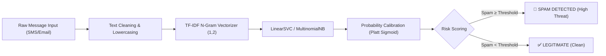

# 🛡️ Spam SMS & Email Classifier (SpamShield AI)

[](https://spamsms-emailclassifier.streamlit.app)
[](https://www.python.org/)
[](https://opensource.org/licenses/MIT)

An enterprise-grade, cybersecurity-themed AI threat detection dashboard designed to classify SMS and email messages as **Spam** or **Legitimate (Ham)** in real time. Built with **Scikit-Learn**, **TF-IDF Vectorization**, **Calibrated Linear SVM**, **Multinomial Naive Bayes**, and **Streamlit**.

🌐 **Live Streamlit App:** [spamsms-emailclassifier.streamlit.app](https://spamsms-emailclassifier.streamlit.app)

---

## 🚀 Key Features

- **Cybersecurity SOC UI/UX:** Modern dark-slate/deep-navy theme inspired by modern security operations centers (SOC), featuring Inter typography, high-contrast threat indicators, and custom telemetry cards.
- **Dual NLP Classification Pipelines:**
  - **Calibrated Linear SVM (Production Engine):** High-recall threat detector (95.31% spam recall, 98.16% test accuracy) utilizing Platt sigmoid probability calibration.
  - **Multinomial Naive Bayes (Conservative Baseline):** High-precision filter achieving 100% precision (zero false positives on the test set).
- **Calibrated Probabilistic Confidence:** Generates mathematically grounded posterior confidence probabilities without heuristic inflation.
- **Interactive Message Inspector:** Quick-load test samples (Phishing, Prize spam, Work sync, Casual communication), live token/character counters, and human-interpretable linguistic risk explanations.
- **Comprehensive Benchmark Dashboard:** Interactive Plotly comparison charts and annotated confusion matrix heatmaps.
- **Interactive Dataset Explorer:** Examine class distributions, inspect the bundled UCI benchmark corpus, or upload custom CSV/TSV batches.

---

## 📊 Empirical Model Benchmarks

Evaluated on the held-out test split (20% test partition, 1,032 samples from the UCI SMS Spam Collection):

| Model Architecture | Accuracy | Precision (Spam) | Recall (Spam) | F1-Score (Spam) | Status |
| :--- | :---: | :---: | :---: | :---: | :---: |
| **Linear SVM (Calibrated)** | **98.16%** | **90.37%** | **95.31%** | **92.78%** | 🛡️ **Production Recommended** |
| **Multinomial Naive Bayes** | 95.54% | 100.00% | 64.06% | 78.10% | ⚡ **Conservative Baseline** |

> **Evaluation Insight:** In cybersecurity threat detection, minimizing missed threats (maximizing Recall) while maintaining high precision is crucial. Calibrated Linear SVM catches 122 out of 128 test spam messages (95.31% recall) with only 13 false alarms out of 904 legitimate messages, making it the superior defensive model.

---

## 🛠️ Architecture & Workflow



---

## 💻 Local Installation & Setup

1. **Clone the repository:**
   ```bash
   git clone https://github.com/SriSaiPranav07/spam_sms-email_classifier.git
   cd spam_sms-email_classifier
   ```

2. **Create and activate a virtual environment:**
   ```bash
   python -m venv venv
   # Windows:
   .\venv\Scripts\activate
   # macOS/Linux:
   source venv/bin/activate
   ```

3. **Install dependencies:**
   ```bash
   pip install -r requirements.txt
   ```

4. **Train models and evaluate benchmarks (optional - models pre-packaged):**
   ```bash
   python train_model.py
   ```

5. **Launch the Streamlit web dashboard:**
   ```bash
   streamlit run app.py
   ```

---

## 🧪 Testing

Run automated tests via pytest:
```bash
pytest
```

---

## 📁 Repository Structure

```
spam_sms-email_classifier/
├── .streamlit/
│   └── config.toml          # Custom dark cybersecurity theme palette
├── data/
│   ├── spam.csv             # UCI SMS Spam Collection dataset
│   └── spam.tsv
├── models/
│   ├── nb_model.pkl         # Trained Multinomial Naive Bayes pipeline
│   ├── svm_model.pkl        # Trained Calibrated Linear SVM pipeline
│   └── metrics.json         # Automated evaluation metrics & confusion matrices
├── src/
│   ├── __init__.py
│   ├── data_loader.py       # Dataset ingestion & preprocessing
│   └── model_utils.py       # Pipeline builders & evaluation logic
├── tests/
│   ├── __init__.py
│   └── test_model.py        # Pipeline integrity tests
├── app.py                   # Streamlit cybersecurity application
├── metrics.json             # Root metrics copy for cloud deployment
├── requirements.txt         # Production dependencies
├── train_model.py           # Model training and benchmark serialization
└── README.md
```

---

## ⚖️ Limitations & Security Boundaries

- **Cross-Domain Validation:** The models are trained on the UCI SMS corpus. While email text testing is fully supported, enterprise email headers, routing metadata, and complex HTML structures are not explicitly modeled.
- **Adversarial Noise:** Token evasions such as zero-width spaces or homoglyph substitutions may alter n-gram representation.
- **Continuous Learning:** Production threat environments benefit from ongoing ingestion of newly discovered spam vectors.

---

## 👤 Author

**Sri Sai Pranav**
- GitHub: [@SriSaiPranav07](https://github.com/SriSaiPranav07)
- Live App: [spamsms-emailclassifier.streamlit.app](https://spamsms-emailclassifier.streamlit.app)
